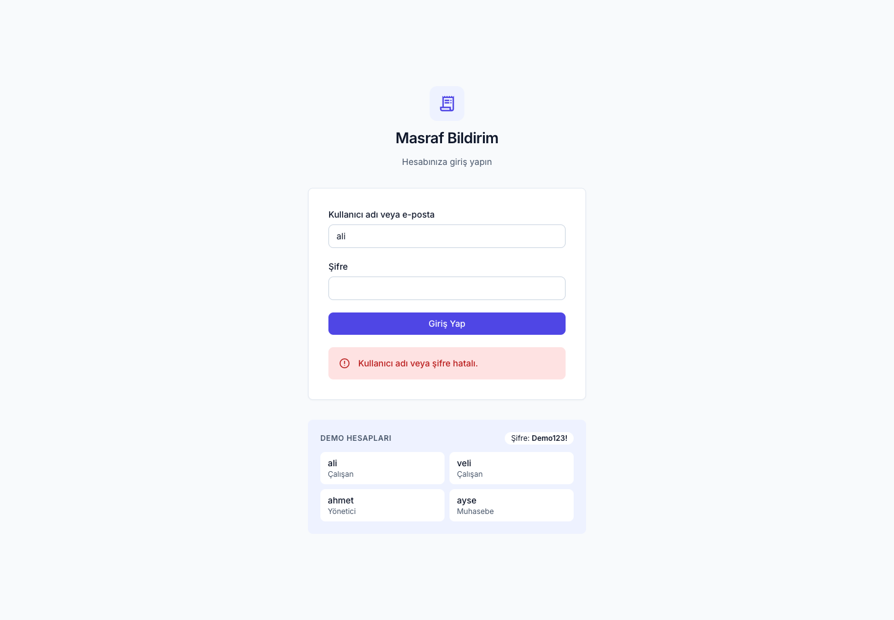
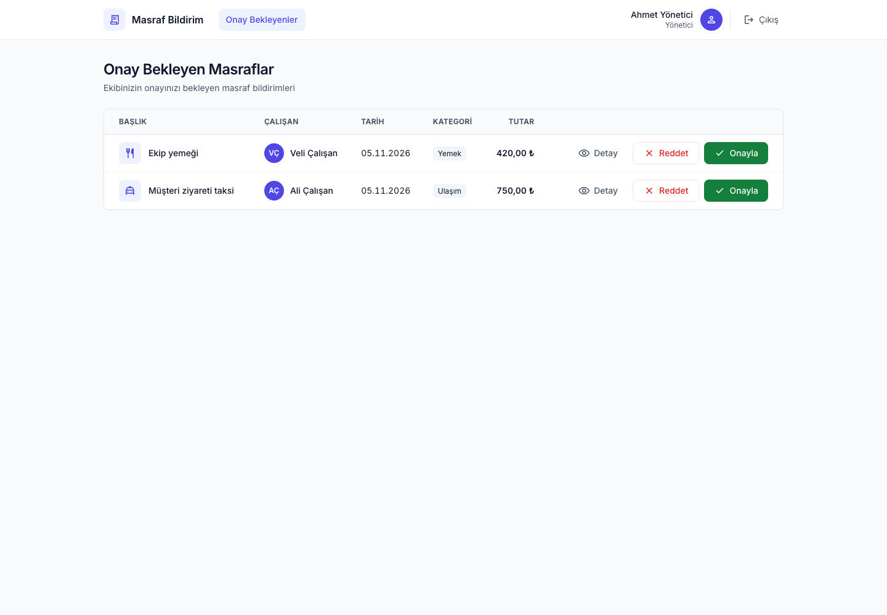
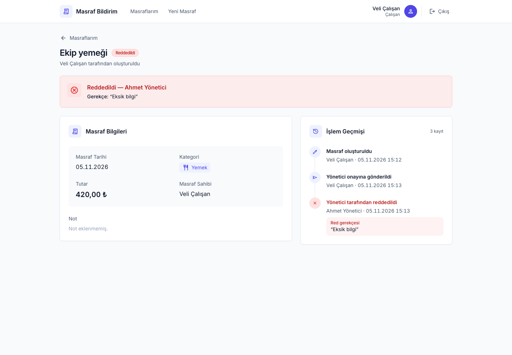
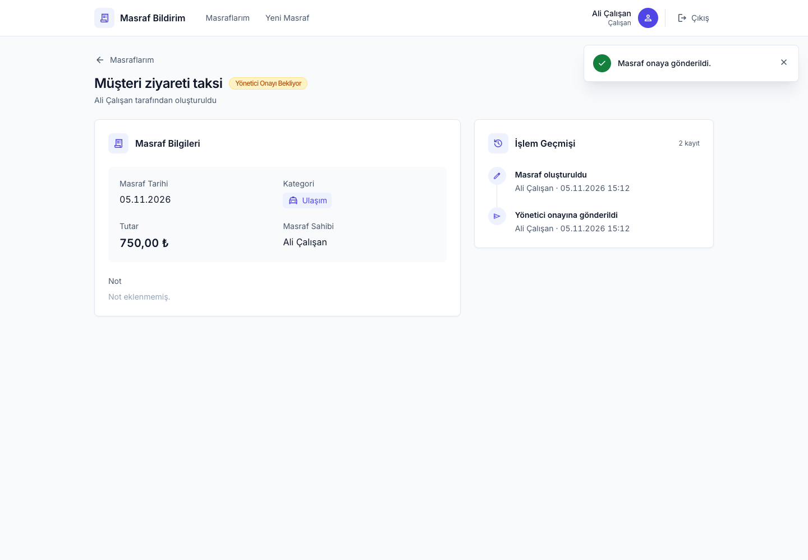
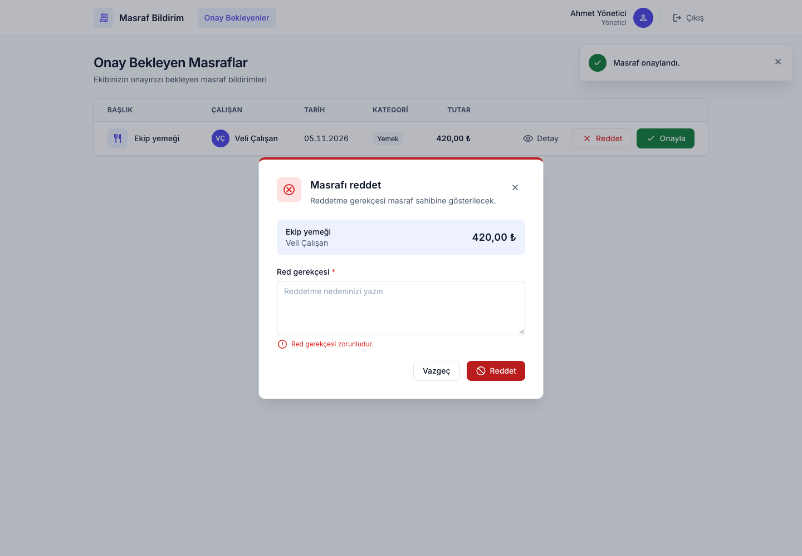
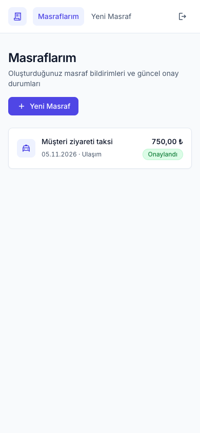

# Masraf Bildirim ve Onay Uygulaması

[](https://github.com/bedirhaneren/expense-approval-app/actions/workflows/ci.yml)

Çalışanların masraf bildirimi oluşturduğu, bildirimlerin önce yöneticinin, ardından muhasebenin onayından geçtiği web tabanlı bir MVP.

**🔗 Canlı demo:** https://expense-approval-app-production.up.railway.app

```
Taslak → Yönetici Onayı Bekliyor → Muhasebe Onayı Bekliyor → Onaylandı
                 ↘ Reddedildi                ↘ Reddedildi
```

| Giriş | Yönetici onay listesi | Reddedilmiş masraf |
|---|---|---|
|  |  |  |
| **Masraf detayı ve işlem geçmişi** | **Reddetme penceresi** | **Mobil görünüm** |
|  |  |  |

---

## İçindekiler
- [Demo kullanıcıları](#demo-kullanıcıları)
- [Kullanılan teknolojiler](#kullanılan-teknolojiler)
- [Kurulum ve çalıştırma](#kurulum-ve-çalıştırma)
- [Testler](#testler)
- [API dokümantasyonu](#api-dokümantasyonu)
- [Proje yapısı](#proje-yapısı)
- [Varsayımlar](#varsayımlar)
- [Bilinen eksikler](#bilinen-eksikler)
- [Ek geliştirmeler](#ek-geliştirmeler)
- [Teknik açıklama](docs/TECHNICAL.md)

---

## Demo kullanıcıları

Tüm kullanıcıların şifresi **`Demo123!`**. Giriş ekranındaki demo kartlarına tıklayınca kullanıcı adı otomatik dolar. Kullanıcı adı veya e-posta ile giriş yapılabilir.

| Kullanıcı adı | E-posta | Rol | Bağlı olduğu yönetici |
|---|---|---|---|
| `ali` | ali@demo.local | Çalışan | Ahmet |
| `veli` | veli@demo.local | Çalışan | Ahmet |
| `ahmet` | ahmet@demo.local | Yönetici | – |
| `ayse` | ayse@demo.local | Muhasebe | – |

Kullanıcılar seed script'i ile otomatik oluşturulur. Gerçek kişi verisi veya gerçek şifre içermez.

---

## Kullanılan teknolojiler

| Katman | Teknoloji |
|---|---|
| Frontend | **Next.js 16** (App Router, Server Components, Server Actions), React 19, Tailwind CSS 4 |
| Backend | **NestJS 12**, class-validator, JWT (`@nestjs/jwt`), bcrypt |
| Veritabanı | **PostgreSQL 16**, Prisma 7 (ORM ve migration) |
| Test | Vitest, Supertest (gerçek veritabanına karşı e2e) |
| Altyapı | Docker / Docker Compose, GitHub Actions (CI), Railway (canlı demo) |

---

## Kurulum ve çalıştırma

### Seçenek A: Docker ile tek komut (önerilen)

Gereken tek şey [Docker](https://www.docker.com/products/docker-desktop/).

```bash
git clone https://github.com/bedirhaneren/expense-approval-app.git
cd expense-approval-app
docker compose up --build
```

İlk build birkaç dakika sürer. Ardından **http://localhost:3000** adresini açın.

Servisler sırayla başlar: `db` → `migrate` (tabloları kurar, demo kullanıcıları ekler ve kapanır) → `api` → `web`. Veriler Docker volume'unda tutulur; container'lar yeniden başlatılınca korunur.

```bash
docker compose down      # durdurur, veriler korunur
docker compose down -v   # durdurur ve veritabanını siler
```

> Not: 3000 ve 5433 portlarının boş olması gerekir.

### Seçenek B: Yerel geliştirme ortamı

Gerekenler: Node.js **22.12+** veya **24+** (geliştirme ve CI'da Node 26 kullanıldı), npm ve Docker (sadece PostgreSQL için).

```bash
npm run install:all                               # iki uygulamanın bağımlılıkları
cp apps/api/.env.example apps/api/.env
cp apps/web/.env.example apps/web/.env.local
npm run db:up                                     # PostgreSQL (Docker, port 5433)
npm run db:setup                                  # migration + demo kullanıcılar

npm run dev:api                                   # API → http://localhost:3001
npm run dev:web                                   # Web → http://localhost:3000 (ayrı terminalde)
```

### Ortam değişkenleri

| Uygulama | Değişken | Açıklama |
|---|---|---|
| API | `DATABASE_URL` | PostgreSQL bağlantı adresi |
| API | `JWT_SECRET` | Token imzalama anahtarı (uzun ve rastgele olmalı) |
| API | `PORT` | Varsayılan `3001` |
| Web | `API_URL` | API'nin adresi. Sadece sunucu tarafında okunur; tarayıcıya açılmaz. |

---

## Testler

```bash
npm run db:up          # API testleri için veritabanı gerekli
npm test               # API: unit + e2e

npm run docker:up      # tarayıcı testleri çalışan bir uygulamaya karşı koşar
npm run browser:install                              # ilk seferde bir kez
npm run test:browser   # gerçek tarayıcıda (Chromium) arayüz testleri
```

| Tür | Sayı | Kapsam |
|---|---|---|
| API unit | 29 | Durum makinesi, görünürlük kuralları, giriş servisi ve hatalı giriş sınırı, rol guard'ı, Türkiye saatiyle tarih kontrolü |
| API e2e | 90 | Case senaryosu, yetki matrisi, iş akışı kuralları, form doğrulamaları, eşzamanlı çift onay, hatalı giriş sınırı |
| Tarayıcı | 9 | Case senaryosu gerçek Chrome'da, yetki yönlendirmeleri, form hata mesajları, taslak düzenleme, mobil görünüm |

- E2E testleri ayrı bir test veritabanında (`masraf_test`) çalışır; geliştirme verisine dokunmaz.
- Test veritabanına, "yönetici sadece kendi ekibini görür" kuralını doğrulamak için ikinci bir ekip (Zeynep → Can) eklenir.
- Tarayıcı testleri her çalıştırmada benzersiz veriler oluşturur; dolu bir veritabanında, hatta canlı demoda da çalışabilir: `BASE_URL=https://... npm run test:browser`.
- Coverage: `npm --prefix apps/api run test:e2e:cov` (API kodu için ~%99 satır, %100 fonksiyon).
- Her push'ta GitHub Actions üç iş çalıştırır:
  - **API:** lint, tip kontrolü, unit ve e2e testleri, OpenAPI belgesinin güncelliği
  - **Web:** lint ve build
  - **Browser:** Docker ile bütün sistem ve Playwright testleri

**Case'te örnek verilen kritik kuralların testleri:**
| Kural | Test |
|---|---|
| Çalışan başka kullanıcının kaydını göremez | `test/access-control.e2e-spec.ts` |
| Muhasebe erken onay veremez | `test/access-control.e2e-spec.ts`, `test/case-scenario.e2e-spec.ts` |
| Aynı bildirime ikinci kez onay verilemez | `test/workflow-rules.e2e-spec.ts` (eşzamanlı istekler dahil) |
| Case'in uçtan uca senaryosu (6 adım) | `test/case-scenario.e2e-spec.ts`, tarayıcıda `apps/web/e2e/case-scenario.spec.ts` |

---

## API dokümantasyonu

- **Etkileşimli Swagger arayüzü:** API çalışırken http://localhost:3001/docs (`npm run dev:api`). Sağ üstteki **Authorize** butonuna `POST /auth/login`'den alınan token girilerek istekler denenebilir.
- **OpenAPI belgesi:** [`docs/openapi.json`](docs/openapi.json). Koddan üretilir (`npm --prefix apps/api run openapi`) ve CI güncel olup olmadığını kontrol eder. Örneğin https://editor.swagger.io adresinde açılabilir.

Bütün uç noktalar, istek ve yanıt şemaları, roller ve olası hata kodları (400, 401, 403, 404, 409, 429) belgelenmiştir. Docker ve canlı ortamda API bilerek dışarıya kapalıdır; bu yüzden Swagger arayüzü yerel geliştirmede kullanılır.

---

## Proje yapısı

```
├── apps/
│   ├── api/                       NestJS backend
│   │   ├── prisma/                şema, migration'lar, seed
│   │   ├── src/
│   │   │   ├── auth/              giriş, JWT guard, rol guard, decorator'lar
│   │   │   ├── expenses/          ⭐ durum makinesi, görünürlük kuralları, masraf işlemleri
│   │   │   ├── approvals/         yönetici ve muhasebe onay uç noktaları
│   │   │   └── common/            ortak doğrulayıcılar ve tarih yardımcıları
│   │   └── test/                  API e2e testleri
│   └── web/                       Next.js frontend
│       └── src/
│           ├── app/               sayfalar ve Server Actions
│           ├── components/        arayüz bileşenleri
│           ├── lib/               API istemcisi, oturum, veri erişim katmanı
│           └── proxy.ts           oturumsuz ziyaretçiyi girişe yönlendirir
│       └── e2e/                   tarayıcı testleri (Playwright)
├── docs/
│   ├── TECHNICAL.md               veri modeli, yetki yaklaşımı, onay akışı
│   └── openapi.json               API belgesi
├── docker-compose.yml
└── .github/workflows/ci.yml
```

---

## Varsayımlar

Case metninin açık bıraktığı konularda verilen kararlar:

1. **Reddedilen masraf son durumdur.** Düzenlenip yeniden gönderilemez; çalışan yeni bir masraf oluşturur.
2. **Masraf tarihi gelecekte olamaz.** "Bugün" sunucu saatine değil, **Türkiye saatine** (Europe/Istanbul) göre belirlenir.
3. **Tutar** TL cinsindendir; sıfırdan büyük olmalı, en fazla 2 ondalık basamak içermeli ve **1.000.000 TL**'yi aşmamalıdır.
4. **Masrafı sadece çalışanlar oluşturur.** Yönetici ve muhasebe için masraf oluşturma tanımlanmadı.
5. **Taslak silme** ve taslağın kısmi güncellemesi yoktur. Düzenleme formu tüm alanları birlikte gönderir.
6. **Görünürlük:**
   - Çalışan sadece kendi masraflarını görür.
   - Yönetici, case'teki ifadeye birebir uygun olarak **sadece kendi ekibinin kendisini bekleyen** (Yönetici Onayı Bekliyor) masraflarını görür. Taslakları ve karar verdiği masrafları göremez; karar verdiği masraf onun için "bulunamadı" olur.
   - Muhasebe, sadece **muhasebe aşamasına ulaşmış** masrafları görür: bekleyen, onaylanan ve muhasebece reddedilen. Yöneticinin reddettiği masrafları görmez.
7. **Yetkisiz erişim 404 döner.** Görme yetkisi olmayan bir kayıt için "yetkiniz yok" (403) yerine "bulunamadı" döner; böylece kaydın var olduğu bilgisi sızmaz. Yanlış rol 403, yanlış işlem sırası 409 döner.
8. **Oturum süresi 8 saattir**; süre dolunca tekrar giriş gerekir.

---

## Bilinen eksikler

- **Listelerde sayfalama, filtreleme ve arama yok.**
- **Hatalı giriş sayacı bellekte tutulur.** Tek API sunucusu için yeterli; birden fazla sunucuya ölçeklenirse Redis gibi ortak bir depoya taşınmalıdır.
- **API ve web arasında tipler kopyalanıyor.** Ortak bir paket yerine `apps/web/src/lib/api/types.ts` API'nin yanıt tiplerini tekrar tanımlıyor.
- **Canlı ortamda yeni migration'lar otomatik uygulanmaz.** Çalışma imajında migration aracı yok ve veritabanı dışarıya kapalı; şema değişikliğinde migration'ın elle çalıştırılması gerekir.
- **Kapsam dışı bırakılanlar:** fiş/dosya yükleme, e-posta/SMS bildirimi, raporlama, çoklu şirket.
- `docker-compose.yml` içindeki `JWT_SECRET` sadece yerel demo içindir. Canlı ortamda ayrı ve gizli bir değer kullanılır.

---

## Ek geliştirmeler

Case'te zorunlu tutulmayan, ama eklenenler:

- **Eşzamanlı çift onay koruması:** Durum kontrolü güncelleme sorgusunun içinde yapılır. Aynı anda gelen iki onaydan sadece biri başarılı olur; bu bir testle doğrulanır.
- **Veritabanı seviyesinde kural:** `CHECK (amount > 0)`.
- **Güvenli giriş:**
  - "Kullanıcı yok" ve "şifre yanlış" durumları aynı mesajı ve aynı süreyi döndürür; kullanıcı adları tahmin edilemez.
  - Aynı hesaba 1 dakika içinde **10 hatalı** denemeden sonra hesap 1 dakika kilitlenir (429). Kullanıcı adı ve e-posta aynı sayacı paylaşır; başarılı girişler sayılmaz.
- **Token güvenliği:** API token'ı httpOnly çerezde tutulur; tarayıcı JavaScript'i okuyamaz. Tarayıcı API ile hiç doğrudan konuşmaz. Docker ve canlı ortamda API dışarıya kapalıdır.
- **Tarayıcı testleri:** Case senaryosu gerçek Chrome'da Playwright ile test edilir.
- **API dokümantasyonu:** Swagger arayüzü ve koddan üretilen OpenAPI belgesi.
- **CI:** Her push'ta lint, tip kontrolü, API testleri, tarayıcı testleri ve OpenAPI güncellik kontrolü çalışır.
- **Docker ile tek komutta kurulum** ve **canlı demo** (Railway).
- **Mobil uyumlu arayüz:** Dar ekranlarda tablolar karta dönüşür.

Mimari, veri modeli, yetki yaklaşımı ve onay akışının detayları için: **[docs/TECHNICAL.md](docs/TECHNICAL.md)**
