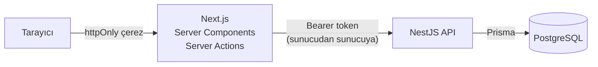
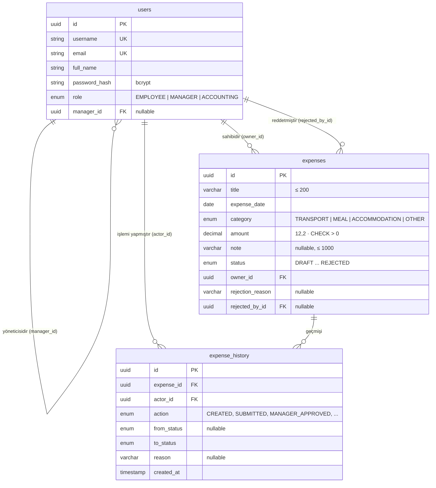
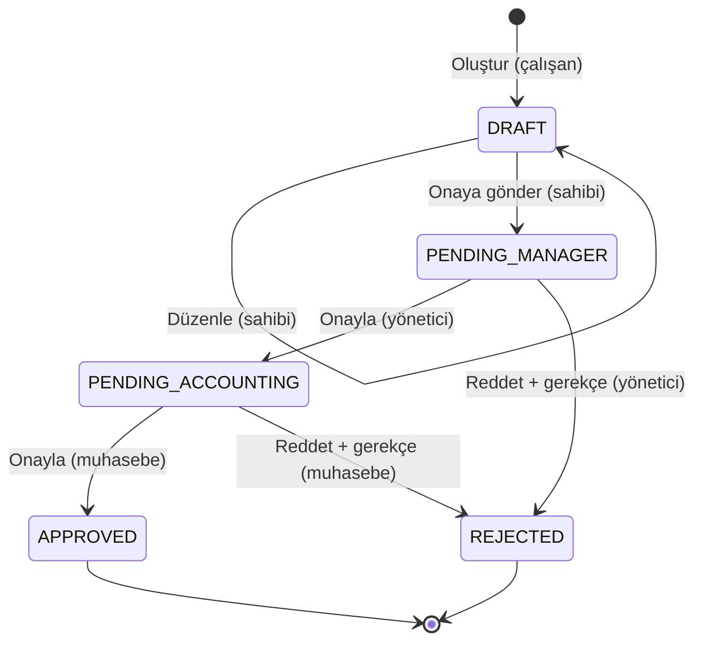

# Teknik Açıklama

Bu belge case'in istediği üç konuyu anlatır: **temel veri modeli**, **rol ve yetki yaklaşımı** ve **onay akışının nasıl uygulandığı**.

- [Mimari](#mimari)
- [Veri modeli](#veri-modeli)
- [Rol ve yetki yaklaşımı](#rol-ve-yetki-yaklaşımı)
- [Onay akışı](#onay-akışı)
- [Doğrulama ve hata yönetimi](#doğrulama-ve-hata-yönetimi)
- [Önemli dosyalar](#önemli-dosyalar)

---

## Mimari



- **Tarayıcı API ile hiç doğrudan konuşmaz.** Sayfalar Next.js sunucusunda hazırlanır; form gönderimleri Server Action'lar üzerinden API'ye iletilir.
- **API token'ı httpOnly çerezde durur.** Tarayıcı JavaScript'i token'a erişemez.
- **Bütün iş kuralları ve yetki kontrolleri API'dedir.** Next.js sadece arayüz kararları verir: hangi sayfaya yönlendirileceği, hangi butonun gösterileceği. Biri arayüzü atlayıp API'ye doğrudan istek atsa bile kurallar aynen uygulanır.
- Docker ve canlı ortamda API **iç ağda** çalışır; dışarıya sadece web açıktır.

---

## Veri modeli



**Tasarım kararları:**
- **Yönetici ilişkisi `users.manager_id` ile kurulur.** "Ahmet sadece kendi ekibini görür" kuralı bu alandan türetilir; ayrı bir ekip tablosu gerekmez.
- **Tutar `DECIMAL(12,2)` olarak saklanır**, ondalık sayı (float) olarak değil. API'den `"750.00"` gibi metin olarak döner; böylece para hesabında yuvarlama hatası olmaz.
- **`expense_history` sadece eklenen bir kayıt defteridir** (append-only). Case'in istediği "işlemi yapan kullanıcı, işlem türü, tarih-saat, red gerekçesi" alanlarını tutar. Ayrıca önceki ve sonraki durumu da saklar.
- **`rejection_reason` ve `rejected_by_id` masrafın üzerinde de tutulur.** Bunlar geçmişte zaten var, ama masraf listelenirken her seferinde geçmişi sorgulamamak için tekrar edilir.
- **Rol, durum, kategori ve işlem türleri PostgreSQL enum'larıdır.** Geçersiz bir değer veritabanına giremez.
- Tablo ve sütun adları PostgreSQL geleneğine uygun olarak `snake_case`, kodda ise `camelCase`. Eşleme Prisma'nın `@map` özelliğiyle yapılıyor.

---

## Rol ve yetki yaklaşımı

Yetki kontrolü **dört katmanda** yapılır. Asıl güvenlik API'deki katmanlardadır.

| Katman | Nerede | Ne yapar | Başarısızsa |
|---|---|---|---|
| 1. Kimlik | `JwtAuthGuard` (global) | Geçerli token var mı? Kullanıcı her istekte veritabanından yeniden okunur. | 401 |
| 2. Rol | `RolesGuard` ve `@Roles()` | Bu uç noktayı bu rol kullanabilir mi? | 403 |
| 3. Kapsam | `visibleExpensesWhere(user)` | Kullanıcı bu masrafı görebilir mi? **Her okuma ve yazma sorgusuna** eklenir. | 404 |
| 4. Akış | Durum makinesindeki `actorRole` | Bu geçişi bu rol yapabilir mi? | 403 |

### Varsayılan olarak kilitli
`JwtAuthGuard` global olarak kayıtlı. Yeni eklenen her uç nokta **otomatik olarak korumalı** olur; herkese açık olması gerekenler (`/auth/login`, `/health`) `@Public()` ile açıkça işaretlenir. Böylece korumayı unutmak mümkün değil.

### Kapsam kuralı: tek fonksiyon
```ts
// apps/api/src/expenses/expense-access.ts
EMPLOYEE   → { ownerId: user.id }
MANAGER    → { owner: { managerId: user.id }, status: PENDING_MANAGER }
ACCOUNTING → status ∈ {PENDING_ACCOUNTING, APPROVED}
             veya muhasebe tarafından reddedilmiş
```
Bu filtre **güncelleme sorgularında da** kullanılır. Birisi ID'yi tahmin edip başka birinin masrafını değiştirmeye çalışsa bile sorgu o kaydı hiç bulamaz.

### Hatalı giriş sınırı
`LoginAttemptLimiter`, bir hesaba 1 dakika içinde yapılan **hatalı** girişleri sayar. 10 hatadan sonra o hesap için giriş 1 dakika boyunca 429 döner.
- **IP'ye göre değil, hesaba göre sayılır.** Bütün istekler API'ye Next.js sunucusundan geldiği için IP'ye göre sayılsaydı bütün kullanıcılar tek bir sayaç paylaşırdı.
- **Sayaç, bulunan kullanıcının kimliğine göre tutulur.** Kullanıcı adı ve e-posta aynı sayacı paylaşır; ikisi arasında geçiş yaparak deneme hakkı artırılamaz.
- **Başarılı girişler sayılmaz** ve sayacı sıfırlar. Şifresini bilen kullanıcı hiçbir zaman kilitlenmez.
- Var olmayan kullanıcı adları da aynı şekilde sayılır ve aynı yanıtı alır; böylece sınır üzerinden kullanıcı adı tahmin edilemez.

### Neden 403 değil de 404?
Görme yetkisi olmayan bir masraf için "bulunamadı" (404) döner. "Yetkiniz yok" (403) demek, "böyle bir kayıt var ama senin değil" bilgisini sızdırır. Aynı yaklaşım giriş ekranında da var: "kullanıcı yok" ve "şifre yanlış" durumları aynı mesajı ve aynı yanıt süresini döndürür.

### Frontend tarafı
- `proxy.ts`: Oturum çerezi olmayan ziyaretçiyi giriş sayfasına yönlendirir. Bu sadece iyimser bir ön kontrol.
- `lib/dal.ts` (Data Access Layer): Kullanıcıyı API'nin `/auth/me` uç noktasından doğrular ve role uymayan sayfadan kullanıcının kendi ana sayfasına yönlendirir.
- Server Action'lar iş kuralı içermez. Gelen ID'yi URL için güvenli hale getirir, isteği kullanıcının token'ıyla API'ye iletir; kararı API verir.

---

## Onay akışı

### Durum makinesi: kuralların tek kaynağı



Geçişler `apps/api/src/expenses/expense-state-machine.ts` dosyasında **tek bir tabloda** tanımlıdır:

| İşlem | Nereden | Nereye | Kim |
|---|---|---|---|
| `SUBMITTED` | DRAFT | PENDING_MANAGER | EMPLOYEE |
| `MANAGER_APPROVED` | PENDING_MANAGER | PENDING_ACCOUNTING | MANAGER |
| `MANAGER_REJECTED` | PENDING_MANAGER | REJECTED | MANAGER |
| `ACCOUNTING_APPROVED` | PENDING_ACCOUNTING | APPROVED | ACCOUNTING |
| `ACCOUNTING_REJECTED` | PENDING_ACCOUNTING | REJECTED | ACCOUNTING |

Tabloda olmayan her geçiş reddedilir. Yönetici ve muhasebe ekranlarının "bekleyen durum" ve "yetkili rol" bilgisi de bu tablodan türetilir; hiçbir yerde tekrar yazılmaz.

### Bir geçiş nasıl uygulanır?

`ExpenseWorkflowService.transition()` her geçişi **tek bir veritabanı transaction'ı** içinde yapar:

```sql
-- 1) Koşullu güncelleme: durum kontrolü UPDATE'in kendisinde
UPDATE expenses
   SET status = 'PENDING_ACCOUNTING'
 WHERE id = $1
   AND <kullanıcının görebildiği masraflar>
   AND status = 'PENDING_MANAGER';      -- beklenen durum

-- 2) Etkilenen satır 0 ise:
--      masraf kullanıcıya görünmüyor → 404
--      görünüyor ama durumu farklı  → 409 "Masraf ... durumunda olduğu için bu işlem yapılamaz."

-- 3) Geçmiş kaydı (aynı transaction)
INSERT INTO expense_history (expense_id, actor_id, action, from_status, to_status, reason) ...
```

**Neden önce okuyup sonra güncellemiyoruz?** "Önce durumu oku, uygunsa güncelle" yaklaşımında, aynı anda gelen iki onay isteği ikisi de "Yönetici Onayı Bekliyor" okuyup ikisi de geçebilir. Durum kontrolü UPDATE'in içinde olduğu için veritabanı bunu **atomik** olarak yapar: İkinci istek geldiğinde durum zaten değişmiştir ve 0 satır günceller. Bu davranış, aynı anda iki istek gönderen bir e2e testiyle doğrulanır.

**Kaybeden istek hangi hatayı alır?** Muhasebede ikinci onay **409** alır, çünkü onaylanan masraf muhasebeye hâlâ görünür. Yönetici aşamasında ise **404** alır: Yönetici sadece kendisini bekleyen masrafları görebildiği için, karar verdiği masraf artık onun kapsamı dışındadır. Ona masrafın yeni durumunu söylemek de bir bilgi sızıntısı olurdu.

**İşlemin sonucu nasıl döner?** Her yazma işlemi masrafın son halini **aynı transaction içinden**, yetki kontrolü geçildikten sonra okuyup döndürür. Böylece yönetici onay verdiği anda sonucu görür, ama sonrasında o masrafı tekrar açamaz.

**Neden transaction?** Durum değişikliği ve geçmiş kaydı ya birlikte olur ya hiç olmaz. "Durum değişti ama geçmişe yazılmadı" gibi yarım bir durum oluşamaz.

### Taslak düzenleme
Aynı koşullu güncelleme mekanizmasıyla yapılır: sadece `status = DRAFT` ve sahibi kullanıcı olan kayıt güncellenir. Gönderilmiş bir masrafı düzenleme denemesi 409 *"Yalnızca taslak durumundaki masraflar düzenlenebilir."* döner.

---

## Doğrulama ve hata yönetimi

**Girdi doğrulama:** class-validator DTO'ları ve global `ValidationPipe` (`whitelist`, `forbidNonWhitelisted`):

| Alan | Kural |
|---|---|
| Başlık | Zorunlu, kırpılır, ≤ 200 karakter |
| Tarih | `YYYY-AA-GG`, gerçek bir tarih (30 Şubat reddedilir), Türkiye saatine göre bugünden ileri olamaz |
| Kategori | ULAŞIM, YEMEK, KONAKLAMA veya DİĞER |
| Tutar | Sayı, > 0, ≤ 2 ondalık, ≤ 1.000.000 |
| Not | Opsiyonel, ≤ 1000 karakter |
| Red gerekçesi | Zorunlu, kırpılır (sadece boşluk kabul edilmez), ≤ 500 karakter |
| Formda olmayan alan | Reddedilir (örneğin `"status": "APPROVED"` gönderilemez) |

Tutar ayrıca veritabanında `CHECK (amount > 0)` ile korunur.

**HTTP hata kodları ve mesajlar:** Bütün mesajlar Türkçedir ve arayüzde gösterilir.

| Kod | Ne zaman | Örnek |
|---|---|---|
| 400 | Form geçersiz | "Tutar sıfırdan büyük olmalıdır." |
| 401 | Giriş yok veya oturum geçersiz | "Bu işlem için giriş yapmanız gerekiyor." |
| 403 | Yanlış rol | "Bu işlem için yetkiniz yok." |
| 404 | Kayıt yok veya görme yetkisi yok | "Masraf bulunamadı." |
| 409 | Yanlış işlem sırası | "Masraf "Onaylandı" durumunda olduğu için bu işlem yapılamaz." |
| 429 | Aynı hesaba çok fazla hatalı giriş | "Çok fazla giriş denemesi yapıldı. Lütfen bir dakika sonra tekrar deneyin." |

Frontend, API'nin doğrulama mesajlarını ilgili form alanının altında gösterir ve kullanıcının girdiği değerleri korur.

---

## Önemli dosyalar

| Dosya | İçerik |
|---|---|
| `apps/api/prisma/schema.prisma` | Veri modeli |
| `apps/api/src/expenses/expense-state-machine.ts` | ⭐ Durum geçiş tablosu |
| `apps/api/src/expenses/expense-access.ts` | ⭐ Rol bazlı görünürlük kuralı |
| `apps/api/src/expenses/expense-workflow.service.ts` | ⭐ Atomik geçişler ve işlem geçmişi |
| `apps/api/src/auth/guards/` | JWT ve rol guard'ları |
| `apps/api/test/access-control.e2e-spec.ts` | Yetki matrisi testleri |
| `apps/api/test/case-scenario.e2e-spec.ts` | Case senaryosunun testi |
| `apps/web/src/lib/dal.ts` | Frontend veri erişim katmanı |
| `apps/web/src/app/actions/` | Server Actions |
| `apps/api/src/auth/login-attempt-limiter.ts` | Hatalı giriş sınırı |
| `apps/web/e2e/` | Tarayıcı testleri (Playwright) |
| `docs/openapi.json` | API belgesi (koddan üretilir) |
